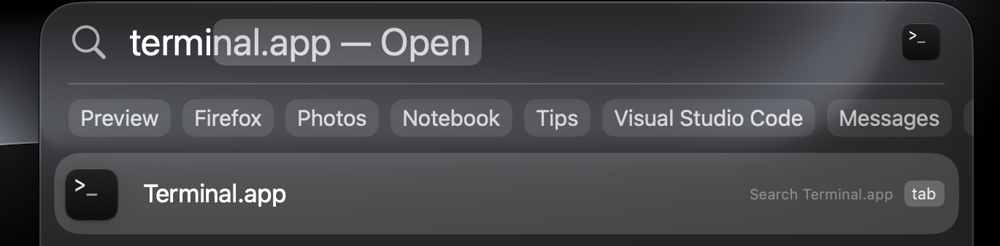
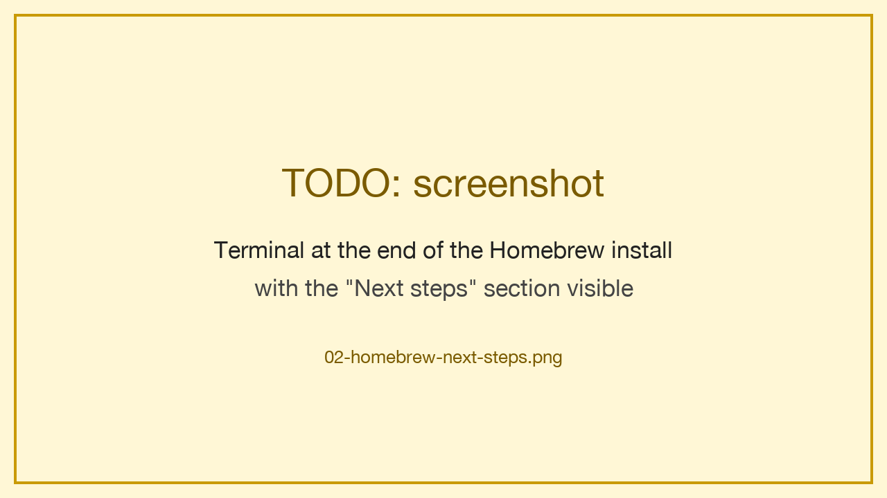
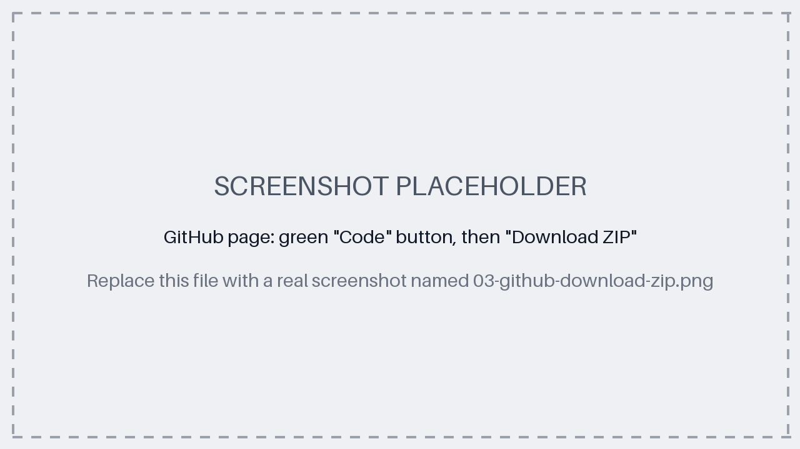
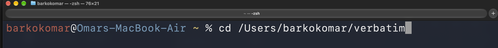
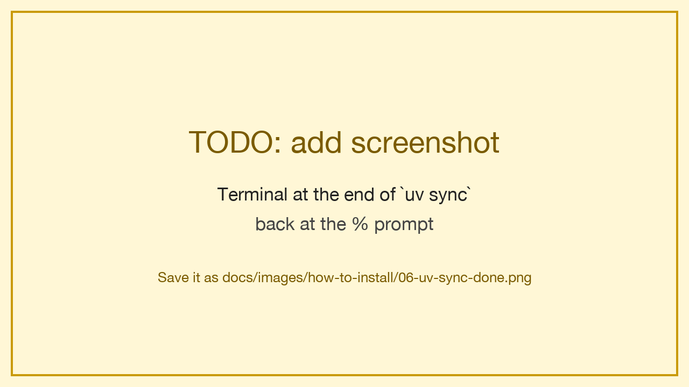
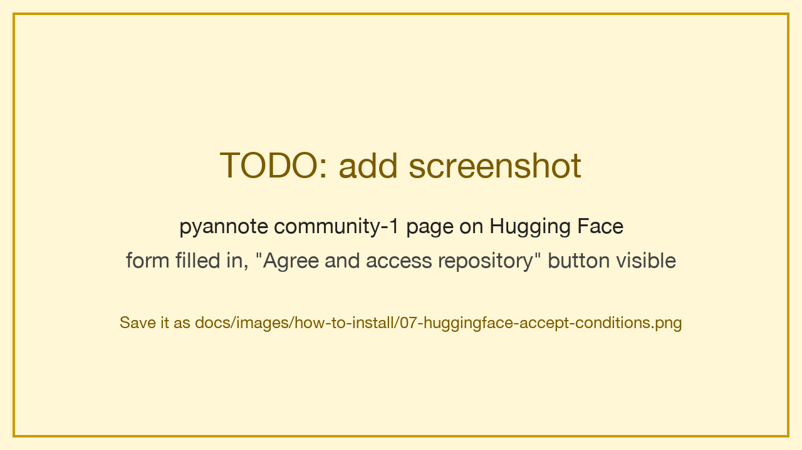
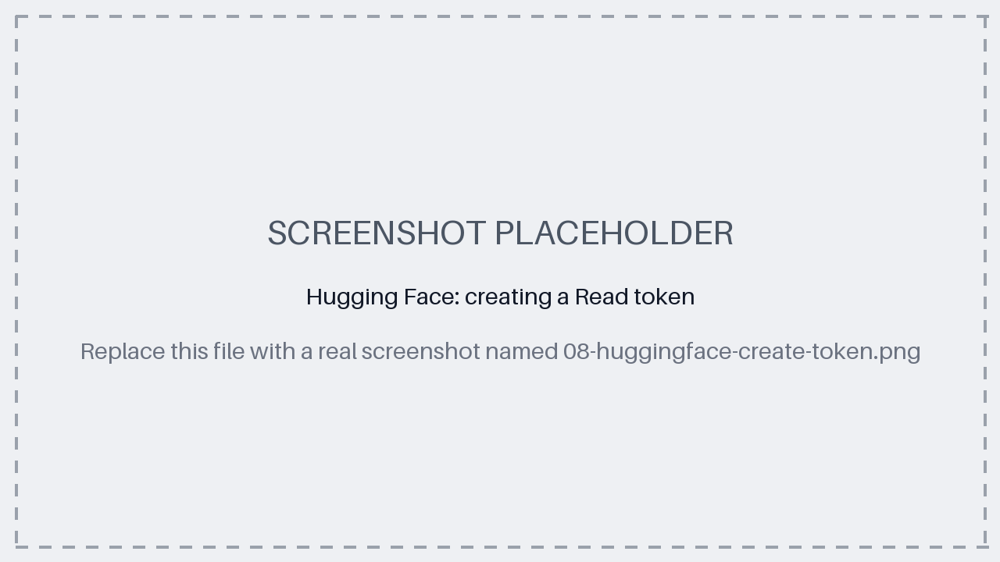
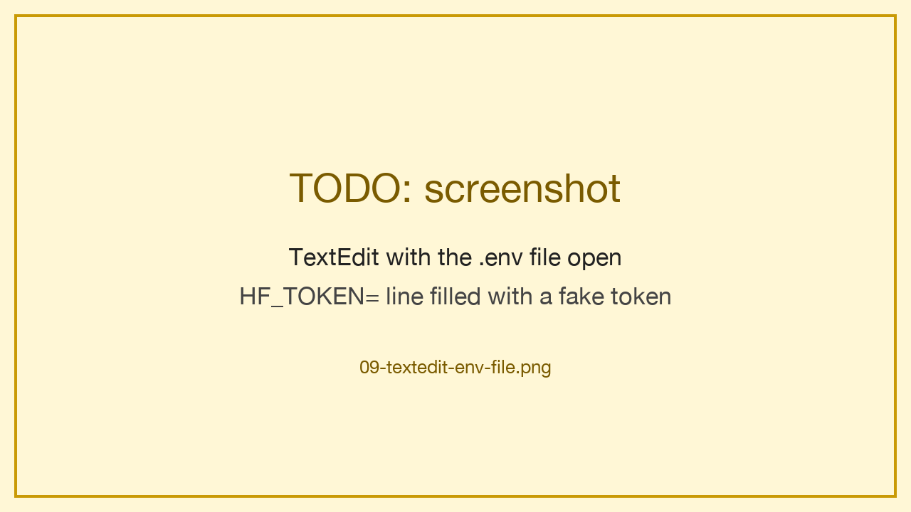
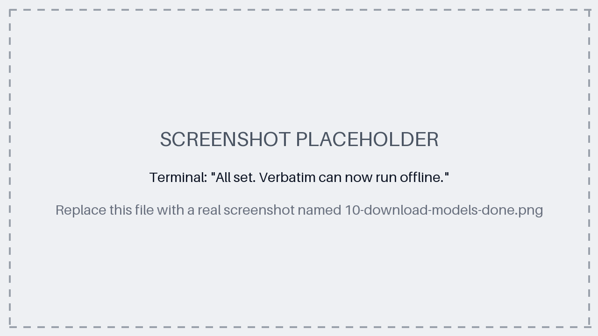
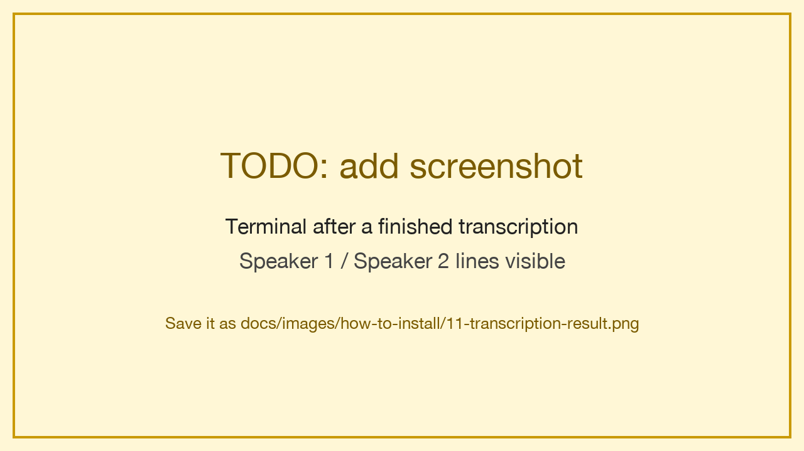

# How to install and use Verbatim

This guide installs Verbatim without needing to know Git or programming: you only copy a few commands into the Terminal.

Verbatim turns a recording of a conversation in French into written text, and shows who said what. Everything happens on your own computer: your recordings are never sent anywhere.

## Contents

- [What you need](#what-you-need)
- [Step 1: Open the Terminal](#step-1-open-the-terminal)
- [Step 2: Install Homebrew](#step-2-install-homebrew)
- [Step 3: Install ffmpeg and uv](#step-3-install-ffmpeg-and-uv)
- [Step 4: Download Verbatim](#step-4-download-verbatim)
- [Step 5: Open the Verbatim folder in the Terminal](#step-5-open-the-verbatim-folder-in-the-terminal)
- [Step 6: Install the parts Verbatim needs](#step-6-install-the-parts-verbatim-needs)
- [Step 7: Get your Hugging Face access key](#step-7-get-your-hugging-face-access-key)
- [Step 8: Download the AI models](#step-8-download-the-ai-models)
- [Step 9: Transcribe a recording](#step-9-transcribe-a-recording)
- [Next time you use Verbatim](#next-time-you-use-verbatim)
- [If something goes wrong](#if-something-goes-wrong)
- [Removing Verbatim](#removing-verbatim)

## What you need

- **A Mac with an Apple chip (M1 or later).** Check in  → **About This Mac**: the **Chip** line must say "Apple M…". Intel Macs cannot run Verbatim. Windows and Linux are not supported yet.
- **16 GB of memory recommended** (shown in the same window). 8 GB may work but has not been tested.
- **About 6 GB of free disk space.**
- **An internet connection, only during installation.** Afterwards, Verbatim works offline.
- **About 30 minutes**, plus download time.

## Step 1: Open the Terminal

Open **Terminal** (Cmd + Space, then type `Terminal`).



To run a command from this guide, paste it into the Terminal and press **Enter**. It has finished when a new line ending with `%` appears.

If the Terminal asks for your **password**, type your Mac login password and press **Enter**. Nothing appears on screen while you type: this is normal.

## Step 2: Install Homebrew

Homebrew is a widely used tool that installs other tools. Check whether you already have it:

```bash
brew --version
```

If you see `Homebrew` followed by a version number, skip to [Step 3](#step-3-install-ffmpeg-and-uv). If you see `command not found`, install it:

```bash
/bin/bash -c "$(curl -fsSL https://raw.githubusercontent.com/Homebrew/install/HEAD/install.sh)"
```

At the end, Homebrew shows a **Next steps** section with two or three commands. Run them one at a time: they let the Terminal find Homebrew.



Then close the Terminal and open it again.

## Step 3: Install ffmpeg and uv

Verbatim needs two tools: `ffmpeg`, which reads audio files, and `uv`, which installs the rest.

```bash
brew install ffmpeg uv
```

## Step 4: Download Verbatim

1. On <https://github.com/m1miage-barkoko/verbatim>, click **Code**, then **Download ZIP**.

    

2. Unzip it, rename the `verbatim-main` folder to `verbatim` and move it to your **home folder**.

> **Important:** do not put the folder on the Desktop or in Documents if your Mac syncs them with iCloud: your recordings would be uploaded to iCloud. The home folder is never synced.

## Step 5: Open the Verbatim folder in the Terminal

Type `cd` followed by a space, drag the `verbatim` folder onto the Terminal window to write its location, then press **Enter**.



Then go into its `backend` folder:

```bash
cd backend
```

## Step 6: Install the parts Verbatim needs

```bash
uv sync
```

This downloads about 1 GB and takes a few minutes.



## Step 7: Get your Hugging Face access key

Verbatim uses a free AI model made by pyannote to tell the voices apart. It is hosted on Hugging Face, which requires a free account and an access key called a **token** to download it.

1. Create an account on <https://huggingface.co/join>.
2. While logged in, open <https://huggingface.co/pyannote/speaker-diarization-community-1>, fill in the short form at the top of the page (for example **Use case**: **Meeting note taker**) and click **Agree and access repository**.

    

3. On <https://huggingface.co/settings/tokens>, click **Create new token**, choose the **Read** type, give it any name and click **Create token**. Copy the token: it starts with `hf_`.

    

4. Create the settings file and open it in TextEdit:

    ```bash
    cp ../.env.example ../.env && open -e ../.env
    ```

5. Paste your token right after `HF_TOKEN=`, with no space, then save and close TextEdit.

    

> **Keep your token private:** never send it to anyone or post it online.

## Step 8: Download the AI models

```bash
uv run python -m app.download_models
```

This downloads about 3.5 GB and can take 5 to 20 minutes. When everything worked, the last line says **All set. Verbatim can now run offline.**



The token is no longer needed after this: you can delete it from `.env` and revoke it on <https://huggingface.co/settings/tokens>.

## Step 9: Transcribe a recording

1. Copy your recording to your Mac. Common formats work: m4a, mp3, wav, aac, ogg, opus, amr, 3gp.
2. In the Terminal, type the command below followed by a space, without pressing **Enter**:

    ```bash
    uv run python -m app.pipeline
    ```

3. Drag your recording onto the Terminal window, then press **Enter**.

Verbatim shows its progress step by step. On a MacBook Air M4, a recording of 1 h 30 takes about 50 minutes. You can keep using your Mac, but leave the Terminal open.

When it is done, the conversation is shown in the Terminal, one line per speaker:



Everything is saved in the `verbatim` folder, under `data/cli/` then the name of your recording: the text with speakers (`transcript.txt`), the text alone (`transcript_plain.txt`) and a copy of the recording.

**Tip:** if you know how many people speak, say so: the speaker separation is more reliable. For example, for 3 people:

```bash
uv run python -m app.pipeline --speakers 3
```

## Next time you use Verbatim

Nothing needs to be installed again, and no internet connection is needed:

1. Open the Terminal ([Step 1](#step-1-open-the-terminal)).
2. Go to the Verbatim folder ([Step 5](#step-5-open-the-verbatim-folder-in-the-terminal)).
3. Transcribe ([Step 9](#step-9-transcribe-a-recording)).

## If something goes wrong

| What you see | What to do |
|---|---|
| `command not found: brew` | Run the **Next steps** commands from [Step 2](#step-2-install-homebrew), then close and reopen the Terminal. |
| `command not found: uv` | Close and reopen the Terminal, then try again. If it persists, redo [Step 3](#step-3-install-ffmpeg-and-uv). |
| `No such file or directory` after `cd backend` | You are not in the Verbatim folder: redo [Step 5](#step-5-open-the-verbatim-folder-in-the-terminal). |
| `Access denied to the model` | Redo point 2 of [Step 7](#step-7-get-your-hugging-face-access-key), logged in with the same account as your token. |
| `A Hugging Face token is needed` | The token is missing from `.env`: redo points 4 and 5 of [Step 7](#step-7-get-your-hugging-face-access-key). |
| `has not been downloaded yet` | Redo [Step 8](#step-8-download-the-ai-models). |
| The text is poor on a very noisy recording | Try again without noise reduction: add `--no-denoise` before dragging the file. |

## Removing Verbatim

Everything Verbatim installs, and how to remove it all, is listed in [UNINSTALL.md](UNINSTALL.md).
