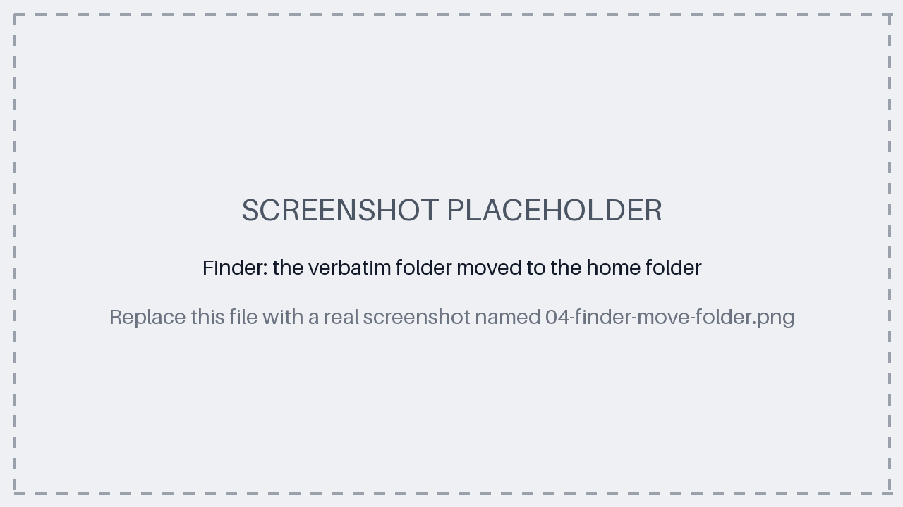

# How to install and use Verbatim (step by step)

This guide is for people who have never used GitHub or a terminal. Follow the steps in order: each
one tells you exactly what to click or what to copy.

Verbatim turns a recording of a conversation in French into written text, and shows who said
what. Everything happens on your own computer: your recordings are never sent anywhere.

> **Good to know:** for now, Verbatim is used by typing a few commands in an app called Terminal.
> A simpler version with a normal window is planned.

## Contents

- [What you need](#what-you-need)
- [Step 1: Open the Terminal](#step-1-open-the-terminal)
- [Step 2: Install Homebrew](#step-2-install-homebrew)
- [Step 3: Install two small tools](#step-3-install-two-small-tools)
- [Step 4: Download Verbatim](#step-4-download-verbatim)
- [Step 5: Open the Verbatim folder in the Terminal](#step-5-open-the-verbatim-folder-in-the-terminal)
- [Step 6: Install the parts Verbatim needs](#step-6-install-the-parts-verbatim-needs)
- [Step 7: Get your Hugging Face access key](#step-7-get-your-hugging-face-access-key)
- [Step 8: Download the AI models](#step-8-download-the-ai-models)
- [Step 9: Transcribe a recording](#step-9-transcribe-a-recording)
- [Next time you use Verbatim](#next-time-you-use-verbatim)
- [If something goes wrong](#if-something-goes-wrong)
- [Removing Verbatim](#removing-verbatim)

## What you need

- **A Mac with an Apple chip (M1 or later).** Verbatim has been tested on a MacBook Air with an
  Apple M4 chip. To check yours, click the Apple menu  at the top left, then **About This Mac**:
  the **Chip** line must say "Apple M…". Macs with an Intel processor cannot run Verbatim. Windows
  and Linux are not supported yet.
- **16 GB of memory recommended** (the same About This Mac window shows it). 8 GB may work but has
  not been tested.
- **About 6 GB of free disk space.**
- **An internet connection, only during installation.** Afterwards, Verbatim works offline.
- **About 30 minutes**, plus download time.

## Step 1: Open the Terminal

The Terminal is an app where you type commands instead of clicking. You will only need to copy and
paste what this guide gives you.

1. Press **Cmd + Space** to open Spotlight search.
2. Type `Terminal`, then press **Enter**.


**How to run a command from this guide:**

1. Copy the text in the grey box (select it, then **Cmd + C**).
2. Click in the Terminal window and paste it with **Cmd + V**.
3. Press **Enter**, then wait until the Terminal shows a new line ending with `%`. That means it
    has finished.

If the Terminal asks for your **password**, type your Mac login password and press **Enter**.
Nothing appears on screen while you type: this is normal.

## Step 2: Install Homebrew

Homebrew is a free, widely used tool that installs other tools. First, check whether you already
have it:

```bash
brew --version
```

If you see `Homebrew` followed by a version number, skip to [Step 3](#step-3-install-two-small-tools).
If you see `command not found`, install it:

```bash
/bin/bash -c "$(curl -fsSL https://raw.githubusercontent.com/Homebrew/install/HEAD/install.sh)"
```

Follow what it asks (your password, then **Enter** to confirm). It can take a few minutes.

At the end, Homebrew shows a **Next steps** section with two or three commands. Copy and run them,
one at a time: they let the Terminal find Homebrew.


Then **close the Terminal and open it again** (Step 1).

## Step 3: Install two small tools

Verbatim needs two tools: `ffmpeg`, which reads audio files, and `uv`, which installs the rest.

```bash
brew install ffmpeg uv
```

## Step 4: Download Verbatim

1. Open the Verbatim page on GitHub: <https://github.com/m1miage-barkoko/verbatim>.
2. Click the green **Code** button, then **Download ZIP**.

    

3. Open your **Downloads** folder and double-click the ZIP file. A folder named `verbatim-main`
    appears.
4. Rename this folder to `verbatim`.
5. Move it to your **home folder**: in Finder, click **Go** in the menu bar, then **Home**, and drag
    the `verbatim` folder there.



> **Important:** do not put the folder on the Desktop or in Documents if your Mac syncs them with
> iCloud. Your recordings would then be uploaded to iCloud. The home folder is never synced.

## Step 5: Open the Verbatim folder in the Terminal

1. In the Terminal, type `cd` followed by a **space**. Do not press **Enter** yet.
2. Drag the `verbatim` folder from Finder and drop it onto the Terminal window. Its location is
    written for you.
3. Press **Enter**.


Then go into its `backend` folder:

```bash
cd backend
```

## Step 6: Install the parts Verbatim needs

```bash
uv sync
```

This downloads about 1 GB and takes a few minutes. It is finished when the `%` line comes back.


## Step 7: Get your Hugging Face access key

Verbatim uses a free AI model, made by a company called pyannote, to tell the voices apart. To
download it, you need a free account on Hugging Face, the website that hosts it, and an access
key called a **token**.

1. Create an account on <https://huggingface.co/join> and confirm your email address.
2. While logged in, open
    <https://huggingface.co/pyannote/speaker-diarization-community-1>. At the top of the page, fill
    in the short form (for example, **Company/university**: your school or company, **Use case**:
    **Meeting note taker**), then click **Agree and access repository**.

    

3. Open <https://huggingface.co/settings/tokens>, click **Create new token**, choose the **Read**
    type, give it any name (for example `verbatim`), then click **Create token**. Copy the token: it
    starts with `hf_`.

    

4. Give the token to Verbatim. Run this command, which creates a settings file and opens it in
    TextEdit:

    ```bash
    cp ../.env.example ../.env && open -e ../.env
    ```

5. In TextEdit, find the line `HF_TOKEN=` and paste your token right after the `=` sign, with no
    space. Save with **Cmd + S** and close TextEdit.

    

> **Keep your token private:** never send it to anyone or post it online.

## Step 8: Download the AI models

```bash
uv run python -m app.download_models
```

This downloads about 3.5 GB and can take 5 to 20 minutes. When everything worked, the last line
says **All set. Verbatim can now run offline.**


Once you see this message, the token is no longer needed. You can delete the token from the
`.env` file and revoke it on <https://huggingface.co/settings/tokens> if you wish.

## Step 9: Transcribe a recording

1. Copy your recording from your phone to your Mac (AirDrop, cable or email). Common formats work:
    m4a, mp3, wav, aac, ogg, opus, amr, 3gp.
2. In the Terminal, type the text below followed by a **space**. Do not press **Enter** yet.

    ```bash
    uv run python -m app.pipeline
    ```

3. Drag your recording from Finder and drop it onto the Terminal window, then press **Enter**.

Verbatim shows its progress step by step. On a MacBook Air M4, a recording of 1 h 30 takes about
50 minutes. You can keep using your Mac, but leave the Terminal open.

When it is done, the conversation is shown in the Terminal, one line per speaker:


A copy is saved in the `verbatim` folder, under `data/cli/` then the name of your recording.

**Tip:** if you know how many people speak, say so. It makes the speaker separation more
reliable. For example, for 3 people, type this before dragging the file:

```bash
uv run python -m app.pipeline --speakers 3
```

## Next time you use Verbatim

You do not need to install anything again, and no internet connection is needed:

1. Open the Terminal ([Step 1](#step-1-open-the-terminal)).
2. Go to the Verbatim folder ([Step 5](#step-5-open-the-verbatim-folder-in-the-terminal)).
3. Transcribe ([Step 9](#step-9-transcribe-a-recording)).

## If something goes wrong

| What you see | What to do |
|---|---|
| `command not found: brew` | Run the **Next steps** commands from [Step 2](#step-2-install-homebrew), then close and reopen the Terminal. |
| `command not found: uv` | Close and reopen the Terminal, then try again. If it persists, redo [Step 3](#step-3-install-two-small-tools). |
| `No such file or directory` after `cd backend` | You are not in the Verbatim folder: redo [Step 5](#step-5-open-the-verbatim-folder-in-the-terminal). |
| `Access denied to the model` | Redo point 2 of [Step 7](#step-7-get-your-hugging-face-access-key), logged in with the same account as your token. |
| `A Hugging Face token is needed` | The token is missing from `.env`: redo points 4 and 5 of [Step 7](#step-7-get-your-hugging-face-access-key). |
| `has not been downloaded yet` | Redo [Step 8](#step-8-download-the-ai-models). |
| The text is poor on a very noisy recording | Try again without noise reduction: add `--no-denoise` before dragging the file. |

## Removing Verbatim

Everything Verbatim installs, and how to remove it all, is listed in [UNINSTALL.md](UNINSTALL.md).
